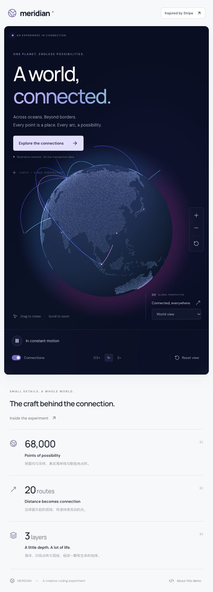

# Meridian Globe

**A little world. A lot of connections.**

[](https://github.com/givingwu/meridian-globe/actions/workflows/ci-pages.yml)
[](LICENSE)

**English** · [简体中文](README.zh-CN.md)

[Explore the globe](https://givingwu.github.io/meridian-globe/) · [Report a bug](https://github.com/givingwu/meridian-globe/issues) · [Contribute](CONTRIBUTING.md)

An interactive globe made with **React, TypeScript, Three.js and Tailwind CSS v4**. Dotted coastlines, a quiet blue-purple atmosphere, and routes that draw themselves across the planet, then disappear.



## Why this exists

The starting point was a simple question: how much of the feeling in [Stripe's globe](https://stripe.com/blog/globe) comes from small, understandable pieces?

Meridian is an attempt to take those pieces apart and put them back together: a sphere that hides the far side, a cloud of land points, a soft halo, and a few curves with carefully chosen timing. You can turn off the connections, pause the motion, or jump to a city to see each layer more clearly.

It is an independent visual experiment, not an official Stripe project or a pixel-perfect clone. The network is illustrative: these are not live payments, flights, or service-coverage claims.

## Take it for a spin

- **Drag** to rotate; **scroll or pinch** to zoom.
- Pick a city or click a marker to focus it. **Explore the connections** takes you to Hong Kong.
- Pause the animation, toggle connections, or try **0.5× / 1× / 2×** speed.
- **Reset view** returns to East Asia. Dragging or scrolling interrupts a camera transition.
- Reduced-motion preferences start the scene paused; you can still choose to play. Hidden tabs stop rendering.

There are **13 cities and 20 directed routes**. Land comes from **68,000 equal-area samples**, filtered to **19,580 land points**. Routes grow for roughly 1.3–1.7 seconds and retract for 2.8–3.6 seconds at 1× speed, with no permanent faint lines underneath. City rings pulse independently.

## Run it locally

Use **Node.js 24.20.0** (see [.node-version](.node-version)) and **pnpm 12.4.2**, matching CI. A modern WebGL-capable browser is required. Tailwind v4 targets modern browsers; this project does not provide a legacy-browser build.

```bash
git clone https://github.com/givingwu/meridian-globe.git
cd meridian-globe
pnpm install --frozen-lockfile
pnpm dev
```

Open the address printed by Vite, normally **http://127.0.0.1:5173/**. No API keys, database, or backend to set up. Google Fonts is the only external page asset; system fonts are used if it cannot load.

| Command                             | What it does                                        |
| ----------------------------------- | --------------------------------------------------- |
| `pnpm dev`                          | Local development with hot reload                   |
| `pnpm build`                        | Strict TypeScript checks and production build       |
| `pnpm preview`                      | Serve the built `dist/` locally                     |
| `pnpm lint`                         | ESLint, including React Hooks rules                 |
| `pnpm test`                         | Geometry, timing, state and camera regression tests |
| `pnpm test:browser`                 | Chromium interaction and WebGL resource checks      |
| `pnpm format` / `pnpm format:check` | Write / check Prettier formatting                   |
| `pnpm generate:land`                | Regenerate the bundled land point cloud             |

Before the first browser test run, install its browser with `pnpm exec playwright install chromium`. On Linux CI, use `pnpm exec playwright install --with-deps chromium`. Tests start a separate local server on port 5174.

## How the globe works

| Layer      | Implementation                                     | Why it is there                                                  |
| ---------- | -------------------------------------------------- | ---------------------------------------------------------------- |
| Ocean      | Opaque sphere + GLSL shading                       | Gives the globe depth and hides routes on the far side           |
| Land       | One `Points` object with a `BufferGeometry`        | Draws thousands of points without thousands of React components  |
| Atmosphere | Camera-facing plane + radial shader                | Adds a soft halo without a hard shell around the sphere          |
| Routes     | Great-circle interpolation + lifted `TubeGeometry` | Keeps paths above the surface, including long-distance routes    |
| Motion     | A visible interval along each route                | Reveals the head, retracts the tail, then leaves the route empty |

The route geometry is built once per mount. `drawRange` removes whole segments and the fragment shader trims the exact endpoints. Frame updates mutate refs and uniforms, reuse scratch objects, and avoid React state updates. Hiding connections unmounts the routes; React Three Fiber disposes their declarative geometry and materials. Showing them starts a fresh staggered sequence.

Camera commands are separate from selection state. One transition controller owns the target, interpolates direction and distance separately, and yields to manual input. Automatic rotation waits until the transition finishes. This also preserves a city selected while the scene's code is still loading.

### Where to look

```text
src/
  app/                         Page composition
  components/                  Shared UI, layout, dialog and error boundary
  hooks/                       Browser visibility and motion preferences
  features/globe/
    GlobeExperience.tsx        Feature UI and lazy-loading boundary
    GlobeCanvas.tsx            Canvas setup and background-tab suspension
    components/                Scene layers, camera adapter and controls
    state/                     Pure interaction reducer and camera commands
    hooks/                     UI event handlers and derived state
    math/                      Coordinates, flight curves, timing, camera transitions
    data/                      Cities, directed routes and generated land points
    shaders/                   GLSL, grouped by visual layer
    config.ts / types.ts       Shared parameters and contracts
  styles/global.css            Tailwind theme, component styles and custom effects
scripts/generate-land.mjs       Offline geographic sampling
tests/                         Unit regressions and browser checks
```

Core code includes Chinese comments explaining units, edge cases, ownership and cleanup. Start with `routeAnimation.ts` for timing, `CameraTransition.ts` for camera motion, or `network.ts` to change the places on the globe.

### Make it yours

| Change                                   | File                                                           |
| ---------------------------------------- | -------------------------------------------------------------- |
| Cities, routes and accent colors         | [network.ts](src/features/globe/data/network.ts)               |
| Route growth / retreat timing            | [routeAnimation.ts](src/features/globe/math/routeAnimation.ts) |
| Home camera and distance limits          | [config.ts](src/features/globe/config.ts)                      |
| Ocean, dots, glow and route shading      | [shaders/](src/features/globe/shaders/)                        |
| Typography, layout and responsive styles | [global.css](src/styles/global.css)                            |
| Land sampling density                    | [generate-land.mjs](scripts/generate-land.mjs)                 |

Route pairs refer to city **array indices**. Reordering cities means updating routes too; the tests catch invalid or disconnected entries. `HK` is a display shorthand, not an airport code.

Tailwind uses the official Vite plugin and CSS-first theme configuration. Shared visual components use `@apply`; simple layouts also use utilities directly in JSX. The existing base reset is retained instead of adding Preflight, so heading defaults, buttons and SVG alignment do not change. Custom CSS remains for layered gradients and exact transitions; WebGL visuals remain in shaders.

## Checks and deployment

```bash
pnpm format:check
pnpm lint
pnpm test
pnpm test:browser
pnpm build
```

CI runs these checks for PRs targeting `master`. Browser tests cover dialog focus restoration, reduced motion, mobile controls, and repeated connection toggles while observing actual WebGL buffer/program allocation and deletion. Unit tests cover camera command ordering, convergence, interrupted motion, geographic edge cases and route boundaries. These are regression checks, not a guarantee of performance on every GPU.

The repository protects `master`, including administrators: use a PR, keep it up to date, pass **Validate and build**, and resolve conversations. No extra reviewer is required for this personal repository. Force pushes and branch deletion are disabled.

After merge, `master` runs validation again and deploys the verified artifact to [GitHub Pages](https://givingwu.github.io/meridian-globe/). PRs cannot deploy. Actions are pinned to commit SHAs; only the deployment job gets Pages/OIDC write permissions.

For your own fork:

1. Enable **Settings → Pages → Source → GitHub Actions**.
2. Keep the default branch named `master`, or update the workflow triggers and conditions.
3. Configure branch protection and the Pages environment in your repository; those settings are not inherited by a fork.

The workflow derives the Pages base path from the repository name. For another static host, adjust `VITE_BASE_PATH` and serve `dist/`:

```bash
VITE_BASE_PATH=/meridian-globe/ pnpm build
pnpm preview
```

## A few honest limits

- This is a visual demo, not a reusable globe SDK or a live network map.
- Three.js and the bundled point data produce large JavaScript chunks. The scene is lazy-loaded, but the build still reports Vite's 500 kB chunk warning.
- Pausing freezes visual time; the foreground canvas still renders so camera controls remain responsive. Hidden tabs stop the frame loop.
- DPR is capped at 1.8. Frame rate depends on your device, viewport and browser; there is no universal 60 fps claim.

If something looks wrong, an [issue](https://github.com/givingwu/meridian-globe/issues) with a screenshot, browser/device details and a short reproduction is more useful than “it feels slow.” Small fixes, clearer explanations and measured performance improvements are welcome. See [Contributing](CONTRIBUTING.md).

## Credits and license

- [Stripe's globe article](https://stripe.com/blog/globe) for the visual and engineering inspiration.
- [Natural Earth](https://www.naturalearthdata.com/) via [world-atlas](https://github.com/topojson/world-atlas) for the public-domain land contours.
- React, Three.js, React Three Fiber, Drei, Tailwind CSS, Vite and Lucide for the building blocks.
- DM Sans and Manrope via Google Fonts for the typography.

Meridian Globe is released under the [MIT License](LICENSE). Third-party packages, fonts and geographic data retain their respective licenses. If you build something with it, a link back is appreciated, but not required by the project beyond the MIT notice requirements.
